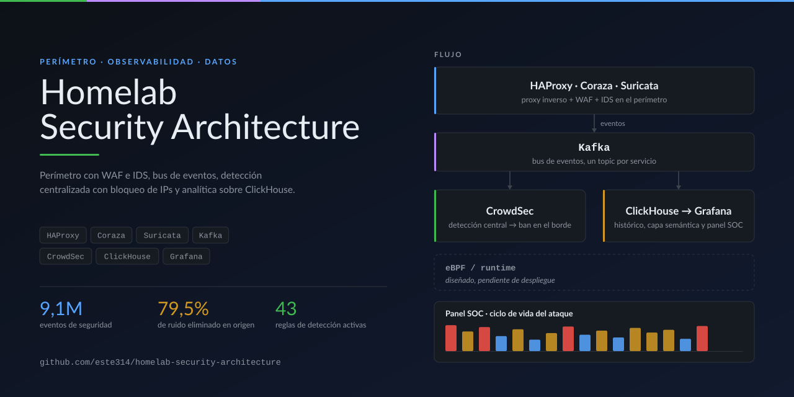
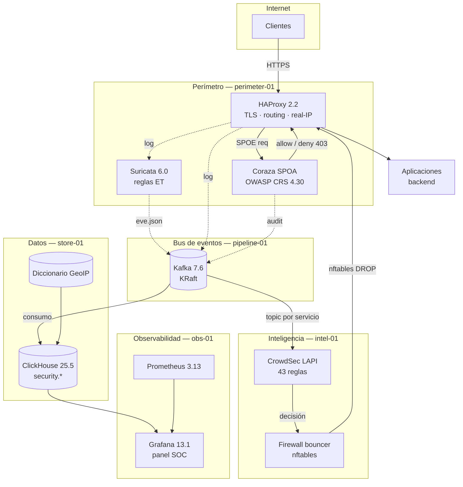
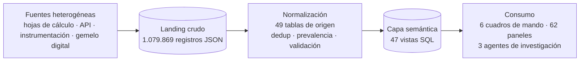
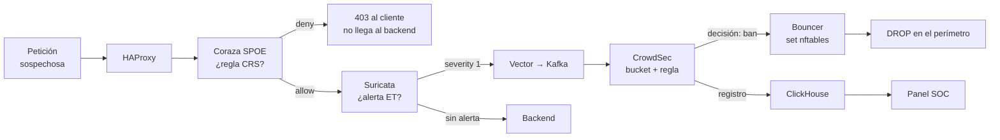
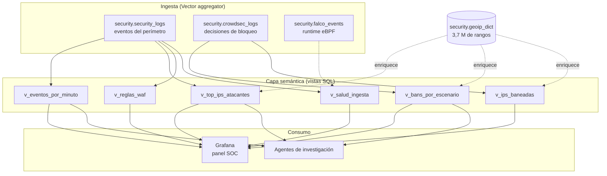

# Homelab Security Architecture

[](https://github.com/este314/homelab-security-architecture/actions/workflows/ci.yml)
[](LICENSE)
[](https://github.com/este314/homelab-security-architecture/commits/main)
[](docs/diagramas/)

**Arquitecturas de seguridad, observabilidad y procesamiento de datos en un
entorno de laboratorio perimetral.** Un único bus de eventos (Kafka) alimenta
dos consumidores independientes —detección y bloqueo (CrowdSec) e histórico y
analítica (ClickHouse)— mientras el perímetro (HAProxy + Coraza + Suricata)
frena el tráfico en L7 y el runtime (eBPF) queda preparado para vigilar lo que
ocurre dentro.

> [!NOTE]
> Repositorio **documental**. Contains the design, the operating procedures and
> **anonymised configuration samples** of a real deployment. No executable stack
> is published here: the configurations are written to be *demo-native*, so any
> value that identifies an infrastructure is replaced by an environment variable
> or a generic placeholder.



---

## Estado de cada pilar

| Leyenda | Significado |
|:--|:--|
| ✅ | **En producción** y verificado sobre la infraestructura real |
| 🧪 | **Diseñado y aprobado**, pendiente de despliegue |
| 📄 | **Documentado** como referencia o próximo paso |

| Pilar | Estado | Resumen |
|---|:--:|---|
| 1 · Perímetro e ingesta | ✅ | HAProxy + Coraza (CRS) + Suricata → Vector → Kafka |
| 2 · Inteligencia y bloqueo centralizado | ✅ | CrowdSec LAPI + bouncer en el perímetro |
| 3 · Seguridad en runtime (eBPF) | 🧪 | Falco + falcosidekick sobre el mismo bus |
| 4 · Observabilidad y analítica | ✅ | Prometheus + ClickHouse + Grafana |
| 5 · Ingesta de datos operativos y agentes | ✅/📄 | ETL genérico + capa semántica + agentes de investigación |

---

## Objetivos del entorno

- **Defensa en profundidad perimetral y detección en runtime.** Controles en
  L7 (WAF), en L3/L4 (IDS/IPS) y en el propio sistema operativo (eBPF), con
  una única fuente de verdad sobre qué está pasando.
- **Centralizar métricas y registros** para garantizar trazabilidad,
  auditabilidad y observabilidad sin duplicar la recolección.
- **Automatizar la ingesta de datos operativos y el triaje inicial** mediante
  una capa semántica versionada y agentes de investigación con acceso a ella.

---

## Arquitectura general



**Los cuatro carriles de tráfico:**

1. **Tráfico de usuario** → TLS terminates en HAProxy, pasa por el SPOE del
   WAF y llega al backend. Una regla del WAF que dispare produce un `403`
   inmediato, sin consumir recursos del backend.
2. **Tráfico de logs** → HAProxy, Suricata y Coraza escriben a disco; un
   agente Vector local lee, normaliza y publica en Kafka con **un topic por
   servicio** (`security-logs-haproxy`, `security-logs-suricata`, …).
3. **Tráfico de inteligencia** → un segundo consumidor de Kafka entrega los
   eventos a CrowdSec, que decide y reparte la decisión al bouncer instalado
   en el perímetro.
4. **Tráfico de métricas** → Prometheus scrapea exporters por *service
   discovery* (Consul); Grafana consulta tanto Prometheus como ClickHouse.

> Los nodos de ingesta de datos operativos del pilar 5 se apoyan en el mismo bus,
> por eso el diagrama de ese flujo está en [`docs/diagramas/D4`](docs/diagramas/).

---

## Pilar 1 · Perímetro e ingesta de eventos ✅

Tres capas de filtrado en el mismo host perimetral, sin proxies adicionales:

| Capa | Componente | Qué hace |
|---|---|---|
| L7 (web) | **Coraza** vía SPOE de HAProxy | Evalúa el OWASP CRS 4.30 sobre la petición; devuelve la acción `deny` al proxy, que responde `403` |
| L3/L4 | **Suricata** | Reglas *Emerging Threats* sobre el tráfico, incluida la Inspection del handshake TLS |
| Proxy | **HAProxy** | Terminación TLS, enrutado por `Host`, IP real de cliente (`CF-Connecting-IP` validada contra la lista de rangos de CDN), y limitación de tasa |

### El pipeline de ingesta

```text
/var/log/haproxy.log ─┐
/var/log/suricata/eve.json ─┼─► Vector (edge) ─► Kafka ─► Vector (aggregator) ─► ClickHouse
/var/log/coraza/audit.log ─┘                        │
                                                        └►►► CrowdSec (vía ficheros) ─► bouncer
```

- **Vector en el edge** parsea cada formato heterogéneo (log-format de
  HAProxy, JSON de Suricata, JSON de auditoría de Coraza) y los homogeneiza
  en un esquema común **antes** de publicar.
- **Kafka desacopla productor y consumidores.** ClickHouse puede estar caído
  sin que se pierdan eventos; CrowdSec y el histórico leen del mismo topic sin
  duplicar la recolección.
- **El aggregator** es el único que escribe en ClickHouse, con batching de
  5.000 eventos y `json_each_row`.

**Volumen real (90 días, con TTL de 3 meses activo):**

| Métrica | Valor |
|---|---|
| Eventos almacenados | 9.101.705 |
| Tamaño comprimido | 6,7 GB (50,4 GB sin comprimir → ratio 7,5×) |
| Fuentes de log | 4 (proxy, IDS, WAF, aplicación) |
| Decisiones de CrowdSec almacenadas | 24.100.100 |
| IPs distintas observadas (proxy) | 9.708 |
| Retención | 3 meses (`TTL`), 90 días (decisiones) |

---

## Pilar 2 · Inteligencia y bloqueo centralizado ✅

**El criterio de diseño: cero agentes pesados por nodo.** En lugar de un
daemon de detección por máquina, hay **un único cerebro** que procesa todos
los logs y **un bouncer ligero** que aplica la decisión en el perímetro.

```text
Vector → Kafka ─► CrowdSec LAPI (detección, buckets, decisiones)
                          │
                          └──► bouncer (nftables/iptables) ─► DROP en el perímetro
```

- **43 reglas activas** repartidas en 37 ficheros de escenario, de las cuales 9
  son propias del entorno (noprovenientes del hub): reglas de severidad
  *critical* de Suricata, intentos de backdoor, ficheros sensibles, rastreo
  agresivo y sondeo web.
- **Dos clases de regla** conviven: `trigger` (dispara al primer evento) y
  `leaky` (requiere *N* eventos distintos en una ventana de tiempo). El
  segundo tipo es el que discrimina un ataque de un cliente legítimo que
  recibe un `404`.
- **El bouncer refresca cada 10 s** y aplica la decisión con un set de nftables
  (`crowdsec-blacklists`), sin reiniciar el proxy ni el firewall.
- **El bouncer es stateless**: todo el estado está en el LAPI. Se puede
  reconstruir un bouncer desde cero en menos de un minuto.

**Decisiones registradas (histórico completo):**

| Escenario | Decisiones | IPs distintas |
|---|---:|---:|
| `crowdsecurity/http-probing` | 759 | 225 |
| `crowdsecurity/suricata-major-severity` | 335 | 208 |
| `crowdsecurity/http-crawl-non_statics` | 209 | 105 |
| `crowdsecurity/http-backdoors-attempts` | 70 | 42 |
| `crowdsecurity/http-sensitive-files` | 3 | 3 |

---

## Pilar 3 · Seguridad en runtime (eBPF) 🧪

**Diseñado y aprobado, pendiente de despliegue.** Falco observa las llamadas
al sistema mediante eBPF para detectar comportamiento anómalo *dentro* del
host y de los contenedores: apertura de shell interactiva, escritura en
ficheros críticos, ejecución de binarios no permitidos.

El diseño reutiliza el bus de eventos existente en lugar de abrir un canal
nuevo:

```text
Falco (eBPF) ─► falcosidekick ─► Kafka (topic security-logs-falco) ─► ClickHouse
                                                     └►►► ClickHouse  ← el mismo aggregator
```

**Por qué este camino y no otro:**

- **Un solo camino de ingesta.** Falco no introduce un segundo formato de
 de ingesta ni un segundo destino; el aggregator ya sabe escribir en la tabla de
  seguridad.
- **El bloqueo de runtime cierra el bucle.** El bouncer de CrowdSec decide
  *en red*; Falco aporta la señal *dentro* de la máquina. Un contenedor que
  abre una shell o toca `/etc/shadow` genera un evento que puede correlacionarse
  con la petición HTTP que lo originó.
- **Coste de despliegue bajo**: `falco-no-driver` (sin módulo de kernel, sin
  recompilar) + `falcosidekick` como enrutador.

Estado actual: configuración preparada en
[`config/falco/falco.yaml`](config/falco/falco.yaml), reglas de detección
propias pendientes de redactar y despliegue en el host perimetral.

---

## Pilar 4 · Observabilidad y analítica ✅

| Componente | Versión | Papel |
|---|---|---|
| Prometheus | 3.13.1 | 21 targets vía *service discovery* (Consul), 823 series |
| node_exporter | 1.x | Métricas de host (10 nodos) |
| cAdvisor | 0.55.1 | Métricas de contenedor (3 hosts) |
| Grafana | 13.1 | 9 paneles, incluido el panel SOC de 18 widgets |
| ClickHouse | 25.5.1 | Histórico columnar + capa semántica |

- **Nada se scrapea dos veces.** Prometheus rastrea las métricas *nativas* de
  CrowdSec (`cs_alerts`, `cs_active_decisions`, `cs_bucket_*`) y de los
  bouncers, mientras que el detalle de cada evento vive en ClickHouse.
- **Service discovery con Consul**: los targets se registran por etiqueta, no
  por IP en la configuración. Añadir un host es registrarlo en el catálogo.
- **El panel SOC** sigue el ciclo de vida completo de un ataque en 6 secciones:
  vista global, línea de tiempo, fase previa (reconocimiento), fase de
  detección, fase posterior (efectividad del bloqueo y reincidencia) e
  inspector de logs con triaje multi-filtro. Detalle en
  [`docs/dashboards.md`](docs/dashboards.md).

---

## Pilar 5 · Ingesta de datos operativos y agentes ✅/📄

Un segundo pipeline, independiente del de seguridad, que ingiere flujos
operativos heterogéneos, los normaliza a un esquema estable y los publica
como una **capa semántica** consultable.



| Etapa | Detalle |
|---|---|
| **Ingesta masiva en bruto** | 1.079.869 registros JSON landing sin preprocesar |
| **Normalización** | 49 tablas de origen con reglas de calidad: deduplicación por clave compuesta, criterio de prevalencia entre fuentes, descarte de ceros no analíticos y de filas con fecha futura |
| **Capa semántica** | 47 vistas SQL que abstraen el modelo físico; 19 de ellas forman la capa analítica de reporting |
| **Consumo** | 6 cuadros de mando (62 paneles) y 3 agentes autónomos de investigación con acceso a la capa analítica |

**Los agentes autónomos** son el último eslabón: no solo responden consultas
SQL, sino que correlacionan eventos anómalos sobre la capa semántica y
producen un diagnóstico técnico. Tres roles: peritación de datos, generación
de informes y analítica.

> **Alcance de la anonimización.** Este pilar se describe en términos
> genéricos de *telemetría y flujos de datos operativos*. No se nombran
> instalaciones, áreas geográficas, equipos concretos ni la instancia de
> visualización que lo sirve: son identificadores de una operación real y
> Omnipresente fuera de este repositorio. Detalle del flujo en
> [`docs/pipeline-datos.md`](docs/pipeline-datos.md).

---

## El embudo de detección

Números agregados de los últimos 30 días, sin identificar ningún atacante:

```text
167.672   peticiones  ──►  proxy inverso (terminación TLS)
   │
 51.997   respuestas 4xx/5xx   (31 % sospechoso)
   │
 23.174   reglas WAF disparadas   (Coraza / CRS)
   │
   313   decisiones de bloqueo   (CrowdSec)
   │
    96   IPs baneadas en el perímetro
```

**Lo que enseña este embudo:** el WAF ve 14 veces más actividad sospechosa que
la que acaba en bloqueo. Bloquear en la capa 7 sin correlatar produce falsos
positivos; correlenar (reglas `leaky`, venting por buckets, reputación) es lo
que permite bloquear con criterio. El 69 % del tráfico marcado como sospechoso
nunca se bloquea, y es correcto que así sea.

### El flujo completo de un ataque hasta el ban



**Latencia total:** del evento a la IP bloqueada, **≤ 10 s** (el periodo de
refresco del bouncer es el cuello de botella dominante).

---

## El hallazgo que motivó el filtrado en el origen

De las 9,1 millones de filas almacenadas, **el 79,5 % no aporta señal**:

| Clase | Filas | % | Origen |
|---|---:|---:|---|
| **Ruido** | 7.237.981 | **79,5 %** | 3 reglas de estado de stream TCP del IDS (`invalid ack`, `packet out of window`) |
| **Útil** | 1.863.724 | 20,5 % | todo lo demás (tráfico, alertas de severidad real, WAF) |

Se manifiesta como picos de volumen anómalo: **1,79 M de filas en un único
día** (30-oct) y **1,74 M** (16-oct), frente a una media de 5.000–50.000.
Ambos picos son **100 % ruido**.



**La decisión:** filtrar en el borde (Vector, antes de publicar en Kafka) y no
en el destino. Se recortan ~7,2 M de filas —un **79,5 % del histórico**— sin
perder ninguna detección real, porque esas tres reglas describen anomalías de
TCP que no se traducen en ataques. Es el motivo por el que el esquema v2
documentado en [`config/clickhouse/schema.sql`](config/clickhouse/schema.sql)
añade campos de severidad explícitos y un nivel de alerta que **no depende del
código de respuesta HTTP**.

> Detalle completo, con el antes y el después, en
> [`docs/arquitectura.md`](docs/arquitectura.md#4-optimización-el-795-de-ruido).

---

## Componentes

| Componente | Versión | Rol | Estado |
|---|---|---|:--:|
| HAProxy | 2.2.9 | Proxy inverso, TLS, IP real, SPOE ×2 | ✅ |
| Coraza + OWASP CRS | CRS 4.30 | WAF L7 vía SPOE | ✅ |
| Suricata | 6.0.1 | IDS/IPS con reglas ET | ✅ |
| Vector (edge) | 0.38.0 | Normaliza y publica en Kafka | ✅ |
| Kafka | 7.6.0 (KRaft) | Bus de eventos | ✅ |
| Vector (aggregator) | 0.57.0 | Consume Kafka → ClickHouse | ✅ |
| CrowdSec | 1.4.6 | LAPI, detección, 43 reglas | ✅ |
| crowdsec-firewall-bouncer | 0.0.36 | Aplica bans con nftables/iptables | ✅ |
| ClickHouse | 25.5.1 | Histórico columnar y capa semántica | ✅ |
| Prometheus | 3.13.1 | Métricas, 21 targets | ✅ |
| Grafana | 13.1 | Paneles y panel SOC | ✅ |
| node_exporter / cAdvisor | 1.x / 0.55.1 | Métricas de host y contenedores | ✅ |
| Consul | — | Service discovery para Prometheus | ✅ |
| Falco | — | Runtime eBPF | 🧪 |
| falcosidekick | — | Enrutador de eventos Falco → bus | 🧪 |

---

## Decisiones de diseño (ADR)

Cada decisión con alternativas descartadas y su coste:

| # | Decisión | Contexto |
|---|---|---|
| [001](docs/adr/001-kafka-como-buffer.md) | Kafka como buffer entre edge y destino | Desacople, replay y consumidores múltiples |
| [002](docs/adr/002-crowdsec-central-sin-agentes.md) | CrowdSec central, sin agente por nodo | Coste cero en cada nodo |
| [003](docs/adr/003-filtrado-en-el-edge.md) | Filtrar ruido en el origen, no en el destino | −79,5 % de volumen |
| [004](docs/adr/004-waf-via-spoe.md) | WAF vía SPOE en lugar de un proxy adicional | Sin salto extra en el camino crítico |
| [005](docs/adr/005-bouncer-en-perimetro.md) | Bouncer en el perímetro y estado centralizado | Ban aplicado en el punto de entrada |
| [006](docs/adr/006-clickhouse-ttl.md) | ClickHouse con TTL y diccionario GeoIP | Histórico acotado sin particionado manual |
| [007](docs/adr/007-runtime-ebpf.md) | Runtime con eBPF sobre el mismo bus de eventos | Un solo camino de ingesta |
| [008](docs/adr/008-no-auditar-cabeceras.md) | El WAF no registra cabeceras de petición | Que una credencial no llegue a existir donde se lee |

---

## Documentación

| Documento | Contenido |
|---|---|
| [`docs/arquitectura.md`](docs/arquitectura.md) | Arquitectura detallada, flujos, matriz de componentes, optimización del 79,5 % |
| [`docs/pipeline-datos.md`](docs/pipeline-datos.md) | Pipeline de datos operativos: landing, normalización, capa semántica, agentes |
| [`docs/dashboards.md`](docs/dashboards.md) | El panel SOC: 18 widgets, SQL de los paneles clave |
| [`docs/detecciones.md`](docs/detecciones.md) | Catálogo de las 43 reglas de detección |
| [`docs/threat-model.md`](docs/threat-model.md) | Modelo de amenazas: activos, actores, superficie, mitigaciones |
| [`docs/runbook.md`](docs/runbook.md) | Procedimientos de operación y mantenimiento |
| [`docs/diagramas/`](docs/diagramas/) | Fuentes Mermaid editables + exports PNG/SVG |

### Diagramas

| # | Diagrama | Fuente | PNG | SVG |
|---|---|---|---|---|
| D1 | Arquitectura general | [`.mmd`](docs/diagramas/D1-arquitectura.mmd) | [PNG](docs/diagramas/D1-arquitectura.png) | [SVG](docs/diagramas/D1-arquitectura.svg) |
| D2 | Flujo de un ataque hasta el ban | [`.mmd`](docs/diagramas/D2-flujo-ataque-a-ban.mmd) | [PNG](docs/diagramas/D2-flujo-ataque-a-ban.png) | [SVG](docs/diagramas/D2-flujo-ataque-a-ban.svg) |
| D3 | Modelo de datos en ClickHouse | [`.mmd`](docs/diagramas/D3-modelo-datos.mmd) | [PNG](docs/diagramas/D3-modelo-datos.png) | [SVG](docs/diagramas/D3-modelo-datos.svg) |
| D4 | Flujo de datos operativos | [`.mmd`](docs/diagramas/D4-flujo-datos-operativos.mmd) | [PNG](docs/diagramas/D4-flujo-datos-operativos.png) | [SVG](docs/diagramas/D4-flujo-datos-operativos.svg) |

Los `.mmd` son la fuente de verdad: se editan en GitHub y se regeneran los
exportados con `npx @mermaid-js/mermaid-cli`.

---

## Configuraciones de ejemplo

[`config/`](config/) contiene las configuraciones **anonimizadas** del
entorno: Vector (edge, aggregator, intel), HAProxy con los dos motores SPOE,
Coraza con la regla de exclusión por token, CrowdSec (adquisición, bouncer y
escenarios propios), el esquema y las vistas de ClickHouse, Prometheus y la
propuesta de Falco.

Todas las credenciales son variables de entorno. Ver
[`.env.example`](.env.example).

---

## Anonimización

Todos los ficheros de `config/` están escritos para ser **demo-native**: los
valores sensibles son variables de entorno y los identificadores de
infraestructura son genéricos.

| Original | Sustituido por |
|---|---|
| Dominios de cliente | `example.com`, `app.example.com`, `api.example.com` |
| IPs internas | `192.168.10.0/24`, `192.168.20.0/24`, `192.168.30.0/24` |
| Nombres de host | `perimeter-01`, `pipeline-01`, `intel-01`, `store-01`, `obs-01` |
| Credenciales | `${CLICKHOUSE_PASSWORD}`, `${CROWDSEC_BOUNCER_API_KEY}`, `${CORAZA_INGEST_TOKEN}` |
| Certificados TLS | `certs/example.com.pem` (no incluidos) |

**La lógica se reutiliza intacta**: el VRL de Vector, el SQL de ClickHouse,
las 43 reglas de CrowdSec y las consultas del panel SOC no contienen datos
identificables y son el valor real de este repositorio.

El CI verifica la anonimización en cada push con dos barriers:
`gitleaks` (secretos por patrón y entropía) y una lista de denegación propia
de PII e identificadores de infraestructura.

---

## Licencia

[MIT](LICENSE) · Documentación y configuraciones de ejemplo.
