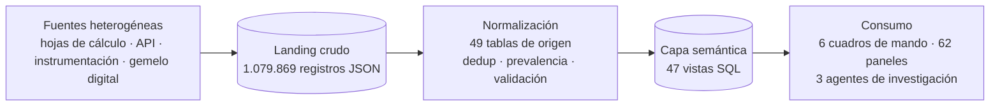

# Pipeline de datos operativos

El segundo pipeline del entorno, independiente del de seguridad. Ingiere
flujos operativos heterogéneos, los normaliza a un esquema estable y los
publica como una **capa semántica** consultable por paneles y por agentes de
investigación.

> [!NOTE]
> **Alcance de la anonimización.** Este pipeline se documenta en términos
> genéricos de *telemetría y flujos de datos operativos*. No se nombran
> instalaciones, áreas geográficas, equipos concretos ni parámetros
> identificativos: son descriptores de una operación real y no aportan nada
> al valor técnico de la documentación. La lógica, las reglas de calidad y las
> cifras agregadas sí son las reales.

---

## 1. El problema

Las fuentes de datos operativos no hablan el mismo idioma:

| Tipo de fuente | Formato | Cadencia | Particularidad |
|---|---|---|---|
| Hoja de cálculo compartida | JSON en bruto, una fila por lectura | Diaria y manual | Puede traer celdas vacías, ceros no analíticos, filas con fecha futura |
| API meteorológica | JSON anidado | Horaria | Series brutas sin normalizar |
| Instrumentación de proceso | Series temporales | Continua | Alta cardinalidad, unidades dispares |
| Gemelo digital | Series derivadas | Diaria | Calculado, no observado |

Volumen del primer trimestre: **1.079.869 registros** en el *landing* crudo.

El problema clásico de este tipo de fuentes no es el volumen, es la
**heterogeneidad semántica**: dos filas que describen lo mismo, escritas por
dos sistemas distintos, con dos convenciones de nulos distintas.

---

## 2. Arquitectura

### 2.1 Landing crudo

Los registros aterrizan **sin transformar**. Es una decisión deliberada: el
landing es la única copia de los datos originales, y conservarla permite
reprocesar cuando cambia una regla de normalización. Sin ella, corregir una
interpretación exigiría volver a la fuente, que es un sistema externo que
puede haber cambiado.

### 2.2 Normalización — 49 tablas de origen

Cada fuente tiene su tabla de destino y suconjunto de reglas. Las reglas de
calidad que se aplican:

| Regla | Qué hace | Por qué |
|---|---|---|
| **Deduplicación por clave compuesta** | Descarta filas cuya clave (instalación + fecha + parámetro + concepto) aparece más de una vez | Dos fuentes pueden emitir el mismo hecho |
| **Prevalencia de fuente** | Cuando interno y externo coinciden, marca cuál manda; si difieren, **conserva ambos** en lugar de promediar | Promediar dos mediciones distintas destruye información que el operador necesita ver |
| **Descarte de ceros no analíticos** | Un 0 en una carga externa equivale a "no se ha analizado", no a "medición cero" | Un 0 falso dispara alertas de cumplimiento |
| **Validación de rango físico** | Descarta valores fuera de rango admisible (p. ej. pH ≤ 0) | Error de captura o de instrumentación |
| **Exclusión de filas futuras** | Excluye del cálculo de frescura cualquier fila con fecha posterior a hoy | Un reloj mal sincronizado no debe invalidar la alerta de "sin datos" |

La regla de **prevalencia sin promediar** es la más importante y la que más
discusión genera: la decisión consciously tomada es *mostrar las dos series*
cuando discrepan, porque un promedio escondería exactamente el desacuerdo que
un operador necesita investigar.

### 2.3 Capa semántica — 47 vistas SQL

Las vistas son el contrato entre los datos y el consumo. Ningún panel escribe
SQL contra las tablas físicas.

- **19 vistas** forman la capa analítica de reporting.
- El resto (28) viven en las bases de origen y sirven para unificar modelos
  duplicados entre bases.

Cada vista encapsulate la lógica de cálculo: unidades, conversiones, uniones
entre fuentes, aplicación de límites y estados. Esto permite que un cambio en
la definición de un indicador se implemente **en un único sitio**.

### 2.4 Consumo

- **6 cuadros de mando, 62 paneles**, que son la lectura operativa diaria.
- **3 agentes autónomos de investigación**, que no responden consultas sino
  que correlacionan eventos anómulos sobre la capa semántica y producen un
  diagnóstico técnico.

---

## 3. Los agentes autónomos

El último eslabón convierte una capa de datos en un sistema que **investiga**.

| Agente | Función | Interfaz |
|---|---|---|
| **Analítica de datos** | Consulta la capa semántica, calcula estados y trends | Lectura de ClickHouse |
| **Peritación de datos** | Ante un valor anómalo, reconstruye el contexto y propone un diagnóstico | Lectura + razonamiento |
| **Generación de informes** | Produce documentos técnicos a partir de los hallazgos | Escritura de documentos |

**La diferencia frente a un panel.** Un panel responde *cuál es el estado*; un
agente responde *qué está pasando y por qué*. El panel detecta que un
indicador se ha salido de rango; el agente correlaciona ese indicador con la
variable que lo explica, la serie histórica, las decisiones de operación
registradas y las alertas del periodo, y devuelve una hipótesis.

**Por qué sobre la capa semántica y no sobre las tablas.** Un agente que
consulta las tablas físicas tiene que reconstruir el significado de cada
columna en cada llamada: multiplica los tokens, multiplica los errores y
produce respuestas inconsistentes entre ejecuciones. Al consultar vistas, la
semántica es la misma para todos y para siempre.

**Restricción de diseño.** El agente no escribe en el almacén. Es un
analista, no un operador: propone, y la ejecución la decide una persona. Esta
separación es lo que permite que un agente con acceso a la capa analítica no
sea, por construcción, un riesgo sobre los datos.

---

## 4. El pipeline de seguridad como precedente

El pilar de seguridad usa exactamente el mismo patrón, y las dos pipelines
comparten el bus de eventos:

| | Pipeline de seguridad | Pipeline de datos operativos |
|---|---|---|
| Fuente | Perímetro (proxy, IDS, WAF) | Fuentes operativas heterogéneas |
| Landing | Topic Kafka por servicio | Tabla de staging en ClickHouse |
| Normalización | VRL en el edge | SQL en la capa de transformación |
| Semántica | Vistas `v_*` | Vistas `v_*` |
| Consumo | Panel SOC | Paneles operativos + agentes |

La diferencia está en el **consumo**: en seguridad, el consumo es reactivo
(bloquear una IP). En datos, es analítico (explicar un indicador). El resto
del diseño es el mismo, y por eso el segundo pipeline se construyó sobre las
mismas piezas.

---

## 5. Estado y siguientes pasos

| Elemento | Estado |
|---|---|
| Landing crudo y normalización | ✅ En producción |
| Capa semántica (47 vistas) | ✅ En producción |
| Paneles operativos (6 cuadros, 62 widgets) | ✅ En producción |
| Agentes de investigación | ✅ Operativos |
| Reglas de calidad como código versionado | 📄 En curso: los umbrales viven hoy en las definiciones de las vistas y deberían pasar a un repositorio con tests de regresión |
| Tests de calidad del dato | 📄 Pendiente: assertions automáticas sobre la capa semántica |
